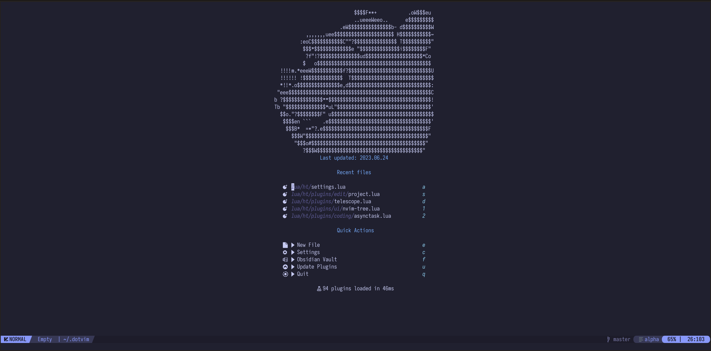

<h1 align="center">dotvim</h1>

<p align="center">
    <a href="https://github.com/TwIStOy/dotvim/pulse">
      </a>
    <a href="https://github.com/TwIStOy/dotvim/blob/master/LICENSE">
      </a>
    <a href="https://github.com/TwIStOy/dotvim/stargazers">
      </a>
    <a href="https://github.com/TwIStOy/dotvim">
      </a>
</p>

<!--  -->

My Neovim configuration, fully managed by [Nix] via [nixvim]. Plugins,
language servers, formatters, treesitter parsers, and external tools are all
built from `flake.nix` — no plugin manager downloads, no `mason`. The flake
produces a single `ne` command (running with `NVIM_APPNAME=ne`), so it never
touches an existing `~/.config/nvim`.

# ✨ Features

- Declarative Neovim configuration with [nixvim] and [flake-parts]
- Plugins, LSP servers, formatters, and binaries resolved entirely from [nixpkgs]
- Language Server Protocol via [nvim-lspconfig]
- Autocompletion with [blink.cmp]
- Formatting with [conform.nvim]
- Snippets with [LuaSnip] and [luasnip-snippets]
- Fuzzy finding with [snacks.nvim]
- Git integration with [gitsigns.nvim], plus a [lazygit] terminal via [toggleterm.nvim]
- GitHub Copilot with [copilot.lua]
- Multiple color schemes: [catppuccin], bamboo, circadia, darkearth, and more
- Runtime configuration (theme, C++ language server) from `~/.config/dotvim/config.json`
- Supported on `x86_64-linux` and `aarch64-darwin`

# ⚡️ Requirements

1. [Nix] with flakes enabled
1. A [Nerd Font] for correct glyph rendering — or a terminal with font
   fallback ([kitty], [wezterm])
1. A terminal with true color support

Everything else — Neovim itself, Node.js for Copilot, language servers,
formatters, lazygit — is bundled by Nix. The only unfree dependency
(`copilot-language-server`) is already allowed inside the flake.

# 📦 Installation

Try it without installing:

```
$ nix run github:TwIStOy/dotvim
```

Install the `ne` command:

```
$ nix profile install github:TwIStOy/dotvim
```

From a checkout of this repo:

```
$ nix profile install .    # or: just build
```

The package also ships `nixvim-print-init`, which prints the fully generated
init.lua for debugging.

# ⚙️ Runtime Configuration

`ne` deep-merges JSON configuration from several files at startup, in
increasing precedence:

1. Built-in defaults (from Nix)
1. `~/.config/dotvim/config.json` — user config
1. `.dotvim.json` — project configs, collected editorconfig-style: every
   `.dotvim.json` found walking from the filesystem root down to the startup
   directory is merged, and the file nearest to the cwd wins on conflicts

```json
{
  "theme": "circadia",
  "cpp_lsp": "clice"
}
```

- `theme` — colorscheme to load; unknown names fall back to `circadia`
- `cpp_lsp` — C++ language server to activate, `clangd` (default) or `clice`

Invalid or missing files are skipped with a warning. A trusted project
`.nvim.lua` (exrc) still runs after all of this and can override anything.

# 🔧 Development

```
$ just test                                    # all tests (plenary.nvim)
$ just test-file tests/spec/commons/fn_spec.lua
$ nix flake check --accept-flake-config        # nixvim module evaluation
```

# 🗿 Legacy

`init.lua` and `lua/dotvim/` are the previous lazy.nvim-based configuration,
kept as reference only — all active development happens in the nixvim modules
under `config/`.

[Nix]: https://nixos.org
[nixvim]: https://nix-community.github.io/nixvim
[flake-parts]: https://flake.parts
[nixpkgs]: https://github.com/NixOS/nixpkgs
[nvim-lspconfig]: https://github.com/neovim/nvim-lspconfig
[blink.cmp]: https://github.com/saghen/blink.cmp
[conform.nvim]: https://github.com/stevearc/conform.nvim
[LuaSnip]: https://github.com/L3MON4D3/LuaSnip
[luasnip-snippets]: https://github.com/TwIStOy/luasnip-snippets
[snacks.nvim]: https://github.com/folke/snacks.nvim
[gitsigns.nvim]: https://github.com/lewis6991/gitsigns.nvim
[lazygit]: https://github.com/jesseduffield/lazygit
[toggleterm.nvim]: https://github.com/akinsho/toggleterm.nvim
[copilot.lua]: https://github.com/zbirenbaum/copilot.lua
[catppuccin]: https://github.com/catppuccin/nvim
[Nerd Font]: https://www.nerdfonts.com
[kitty]: https://sw.kovidgoyal.net/kitty/conf/#opt-kitty.symbol_map
[wezterm]: https://wezfurlong.org/wezterm/config/lua/wezterm/font_with_fallback.html
